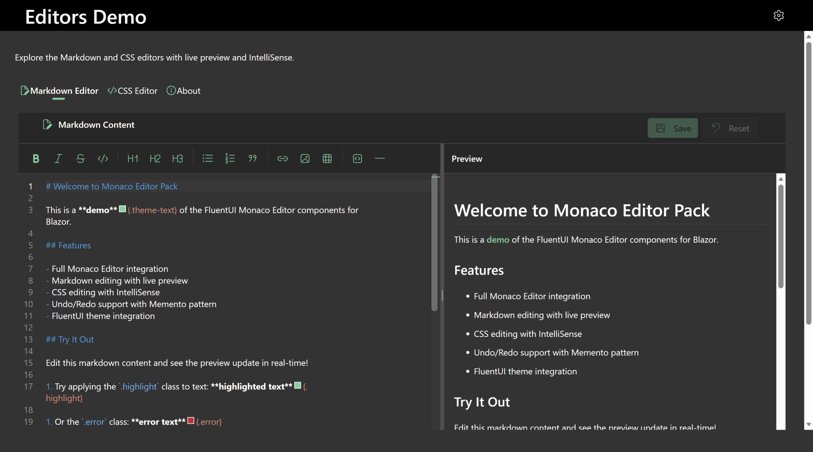
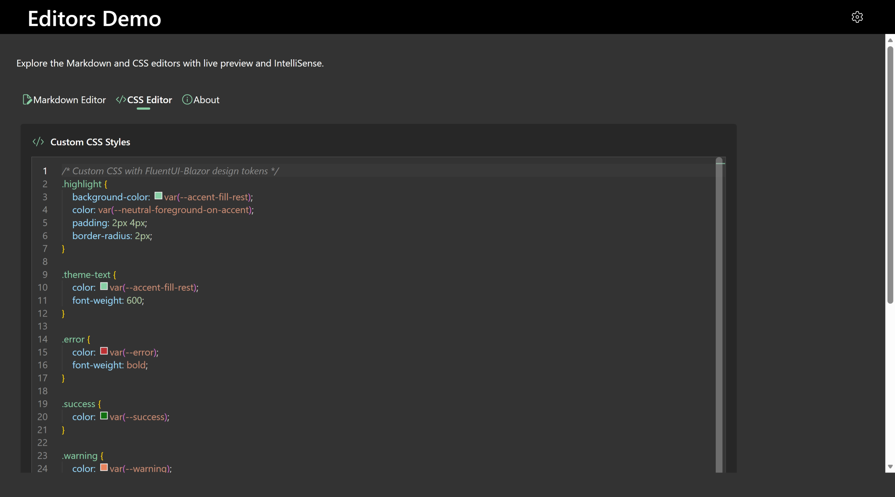

# FluentUI Blazor Monaco Editor Pack


Monaco Editor integration for Blazor with FluentUI components — includes Markdown and CSS editors with IntelliSense, live preview, and theme integration.

[](https://www.nuget.org/packages/FluentUI.Blazor.Monaco.EditorPack/)

---

## Live Demo

### **[Try the interactive demo](https://gerfen.github.io/FluentUI.Blazor.Monaco.EditorPack/)**

---

## Screenshots





---

## Features

- **Markdown Editor** — Live preview, CSS class IntelliSense, toolbar, undo/redo  
- **CSS Editor** — FluentUI design token IntelliSense, color swatches, auto‑completion  
- **Theme Integration** — Automatic dark/light mode support  
- **Monaco lifecycle hooks** — Run code *before* Monaco is created and *after* the editor instance is available  
- **Configurable Markdig pipeline** — Toggle common Markdig extensions via `MarkdownOptions`  
- **WYSIWYG editor (separate package)** — [FluentUI.Blazor.Monaco.EditorPack.Wysiwyg](FluentUI.Blazor.Monaco.EditorPack.Wysiwyg/README.md) adds a Milkdown-based visual Markdown editor with Fluent theming  
- **Unified Monaco configuration** — Strongly‑typed `MonacoOptions` for editor behavior, theme, and front‑matter support  

---

## 📘 Migration Guide

> **Fluent UI Blazor v5:** This version is built on **Microsoft.FluentUI.AspNetCore.Components 5.x**. Fluent UI Blazor v5 contains breaking changes, so your application must also be on v5.

➡️ **[Upgrade Guide: Fluent UI Blazor v4 → v5](UPGRADE_GUIDE_FLUENTUI_V5.md)**

If you are upgrading from **0.1.x** to **0.2.0‑preview**, please read the migration guide:

➡️ **[Migration Guide](MIGRATION_GUIDE.md)**

---

## Quick Start

### 1. Install Package

```bash
dotnet add package FluentUI.Blazor.Monaco.EditorPack
```

### 2. Register Services

Add to `Program.cs`:

```csharp
builder.Services.AddMonacoEditorPack();
builder.Services.AddFluentUIComponents();
```

The Markdown preview is sanitized. Raw `<style>` and `<iframe>` elements in Markdown are removed by default; if your authors are trusted, opt in:

```csharp
builder.Services.AddMonacoEditorPack(o =>
{
    o.AllowStyleTags = true;
    o.AllowIframes = true;
});
```

### 3. Add Styles and Scripts

**Blazor Server** (`App.razor`):

```html
<head>
    <link href="_content/Microsoft.FluentUI.AspNetCore.Components/Microsoft.FluentUI.AspNetCore.Components.bundle.scp.css" rel="stylesheet" />
    <script src="_content/Microsoft.FluentUI.AspNetCore.Components/Microsoft.FluentUI.AspNetCore.Components.lib.module.js" type="module" async></script>
</head>
<body>
    <Routes @rendermode="new InteractiveServerRenderMode(prerender: true)" />
    <script src="_framework/blazor.web.js"></script>

    <!-- Monaco Editor Scripts -->
    <script src="_content/FluentUI.Blazor.Monaco.EditorPack/lib/monaco-editor/min/vs/loader.js"></script>
    <script src="_content/FluentUI.Blazor.Monaco.EditorPack/js/monaco-editor-pack.js"></script>
</body>
```

**Blazor WebAssembly** (`index.html`):

```html
<head>
    <link href="_content/Microsoft.FluentUI.AspNetCore.Components/Microsoft.FluentUI.AspNetCore.Components.bundle.scp.css" rel="stylesheet" />
    <script src="_content/Microsoft.FluentUI.AspNetCore.Components/Microsoft.FluentUI.AspNetCore.Components.lib.module.js" type="module" async></script>
</head>
<body>
    <div id="app">...</div>
    <script src="_framework/blazor.webassembly.js"></script>

    <!-- Monaco Editor Scripts -->
    <script src="_content/FluentUI.Blazor.Monaco.EditorPack/lib/monaco-editor/min/vs/loader.js"></script>
    <script src="_content/FluentUI.Blazor.Monaco.EditorPack/js/monaco-editor-pack.js"></script>
</body>
```

### 4. Add `FluentProviders`

Fluent UI Blazor v5 requires `FluentProviders` at the end of your main layout (it replaces the v4 provider components and `FluentDesignTheme`):

```razor
@* MainLayout.razor *@
@Body
<FluentProviders />
```

---

## Using the Components

### Markdown Editor

```razor
<MonacoMarkdownEditor @ref="editor"
                      Markdown="@content"
                      MarkdownChanged="@OnChanged" />

@code {
    private MonacoMarkdownEditor? editor;
    private string content = "# Hello World";

    private Task OnChanged(string newContent)
    {
        content = newContent;
        return Task.CompletedTask;
    }
}
```

### Configuring Markdig (Markdown Preview)

```razor
@using FluentUI.Blazor.Monaco.EditorPack.Markdown

<MonacoMarkdownEditor Markdown="@content"
                      MarkdownChanged="@OnChanged"
                      MarkdownOptions="@options" />

@code {
    private string content = "# Hello World";

    private readonly MarkdownOptions options = new() {
        EnableFrontMatter = true,
        EnableTables = true,
        EnableTaskLists = true,
        EnableGenericAttributes = true,
        EnableAutoIdentifiers = true,
        EnableAutoLinks = true,
        EnableEmphasisExtras = true,
        EnableListExtras = true,
        EnableFencedCodeBlocks = true
    };

    private Task OnChanged(string newContent)
    {
        content = newContent;
        return Task.CompletedTask;
    }
}
```

### Monaco Lifecycle Hooks

`MonacoMarkdownEditor` exposes two optional lifecycle hooks:

- `BeforeCreated` — called before Monaco is created  
- `AfterInitialized` — called after the editor instance is available  

```razor
<MonacoMarkdownEditor Markdown="@content"
                      MarkdownChanged="@OnChanged"
                      BeforeCreated="@OnBeforeCreated"
                      AfterInitialized="@OnAfterInitialized" />

@code {
    private string content = "# Hello World";

    private Task OnChanged(string newContent)
    {
        content = newContent;
        return Task.CompletedTask;
    }

    private Task OnBeforeCreated(IJSRuntime js)
    {
        // Configure Monaco before creation (languages, themes, etc.)
        return Task.CompletedTask;
    }

    private Task OnAfterInitialized(IJSObjectReference editor)
    {
        // Editor instance is available
        return Task.CompletedTask;
    }
}
```

### CSS Editor

```razor
<MonacoCssEditor @ref="cssEditor"
                 Css="@cssContent"
                 CssChanged="@OnCssChanged" />

@code {
    private MonacoCssEditor? cssEditor;
    private string cssContent = ".my-class { color: var(--accent-fill-rest); }";

    private Task OnCssChanged(string newCss)
    {
        cssContent = newCss;
        return Task.CompletedTask;
    }
}
```

---

## Detailed Setup

- **Blazor Server**:  
  [Demo App Setup Guide](https://github.com/gerfen/FluentUI.Blazor.Monaco.EditorPack/blob/master/FluentUI.Blazor.Monaco.EditorPack.DemoApp/wwwroot/SETUP_GUIDE.md)

- **Blazor WebAssembly**:  
  [WASM Demo Setup Guide](https://github.com/gerfen/FluentUI.Blazor.Monaco.EditorPack/blob/master/FluentUI.Blazor.Monaco.EditorPack.WasmDemo/wwwroot/SETUP_GUIDE.md)

---

## Requirements

- .NET 9.0 or .NET 10.0  
- Microsoft.FluentUI.AspNetCore.Components 5.0.0+ (Fluent UI Blazor v5)

---

## License

MIT License — see [LICENSE](LICENSE.txt)
